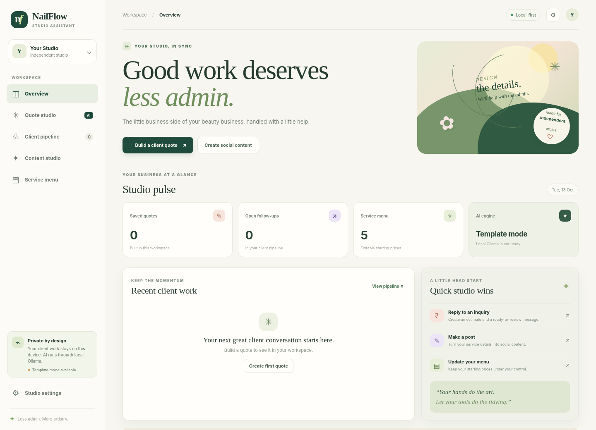
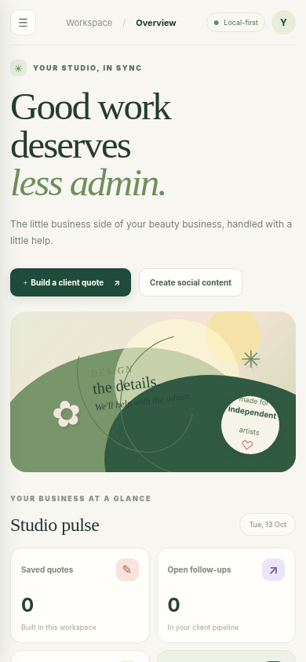

# NailFlow AI 🌿

**A local-first studio assistant for independent nail artists.** NailFlow turns a client inquiry into a transparent price estimate, a human-reviewable WhatsApp reply, aftercare notes, and a gentle follow-up. It also creates social content from a studio's own details.

NailFlow is built for the Hacktoberfest 2026 DEV Challenge Week 2 theme: **Side Hustle**. It is a new, standalone project, separate from WildMinute.

## Preview

The screenshots below show the current UI in its clearly labelled Template Mode. Real local-AI generation requires Ollama and the configured model; the screenshot is not evidence of a live model response.





## What it helps with

- **Quote Studio:** create a price estimate based on the studio's own editable service menu, selected design complexity, and optional extras.
- **Client-ready, editable drafts:** generate a WhatsApp reply, social caption, general aftercare notes, and a follow-up message; edit each field in place before copying or saving.
- **Content Studio:** draft an Instagram caption, short story/status, hashtags, and a call to action.
- **Client Pipeline:** save quotes locally and mark a conversation Draft, Follow-up, or Done.
- **Service Menu:** add services and edit starting prices and session durations.
- **Local data controls:** studio settings, quotes, and content drafts stay in the current browser; export a JSON backup or clear local data.
- **Honest fallback:** when Ollama is not running or a model is missing, the UI marks output as Template Mode instead of pretending it was AI-generated.

## Why open-weight AI is core

NailFlow uses **Gemma 3 1B through Ollama** by default. When the model is installed and running locally, the Node.js server sends the prompt to the Ollama service on the same machine. There is no hosted AI endpoint, API key, user account, or analytics service in this project.

The prompts, bounded output parser, and post-generation quote guardrails are in `lib/core.js`, so a developer can inspect or modify the rules, change the model via `OLLAMA_MODEL`, or adapt the workflow to a specific studio. Local inference avoids a per-generation hosted API bill and keeps client inquiry text on the machine where Ollama is running. When using a local model, the browser's request goes to this local Node server, which talks to local Ollama.

Gemma is an open-weight model, but open weights are not automatically the same as OSI-approved open-source software. Review the model's license and terms before redistributing weights. NailFlow does not package model files.

## Run locally

Requirements: Node.js 18.18+; [Ollama](https://ollama.com/download) for local-AI generation. The app itself has no npm dependencies.

```bash
ollama pull gemma3:1b
npm run check
npm test
npm start
```

Open <http://127.0.0.1:4174>.

To use a different Ollama-compatible model or port:

```bash
# Windows PowerShell
$env:OLLAMA_MODEL = "gemma3:1b"
$env:PORT = "4174"
npm start
```

Without Ollama, you can still explore the app and use clearly-labelled template output. AI requests are made by the local server to Ollama; the app does not call a remote inference provider.

## Test

```bash
npm run check
npm test
```

The automated suite contains 20 tests across core logic and HTTP integration. It validates input bounds, deterministic prices, post-generation quote guardrails, bounded response parsing, English/Gujarati template fallback, the mocked Ollama bridge, fallback behavior, error handling, request-size limits, and path traversal protection. The integration tests use a fake Ollama server; they are not a substitute for testing real Gemma inference in the browser.

## Price handling and safety

- The starter service prices are **editable demo values**, not a recommendation or market survey. Set your real menu before quoting clients.
- The quote is computed in code, separately from generated wording. Post-generation guardrails normalize detected currency amounts and defang several common direct booking-confirmation claims. These are safeguards, not a guarantee that every generated sentence is correct, so review every reply before sending.
- Every generated message should be reviewed before sending. NailFlow does not automatically contact a customer or book a slot.
- Aftercare copy is general cosmetic guidance, not medical advice. The app avoids claiming medical benefits or guaranteeing outcomes.
- Use minimal client information. Quote data is stored in browser `localStorage` on this device; exports are unencrypted JSON and should be kept private.
- Local inference is local only when the app's Node server and Ollama are running on the same trusted machine. If Ollama is configured to a different host, prompts go to that host.

## Demo plan

For a contest demo, screen-record a real run on your machine showing: edit a service price, generate a client pack with Gemma (the badge should say **LOCAL AI**), copy but do not send the draft, save it to the pipeline, and generate a content pack. If Ollama isn't available, record Template Mode honestly and do not describe those drafts as AI-generated.

The Week 2 contest allows a deployed project **or a video demo**. This project currently runs locally; no hosted demo URL is claimed in this repository. To demonstrate the AI honestly, show the sidebar reporting Gemma ready, generate one quote, then show the result labelled `LOCAL AI`. If your screen says Template Mode, use the fallback demo and do not describe it as model-generated.

## Demo recording guide

See [`DEMO-GUIDE.md`](DEMO-GUIDE.md) for a short, honest recording walkthrough and preflight steps.

## Stack

- Node.js built-in HTTP server (no third-party runtime packages)
- Vanilla JavaScript and CSS
- `localStorage` for local workspace data
- Ollama local HTTP API
- Gemma 3 1B by default
- Node's built-in test runner

## Project layout

```text
public/       Responsive PWA-style interface, UI logic, theme and service worker
lib/core.js   Validation, deterministic pricing, prompt building and output parsing
server.js     Local static server and Ollama bridge
test/         Node-native test suite
```

## License

MIT. See `LICENSE`.
